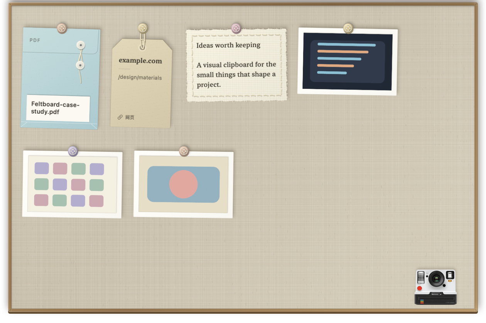

# Feltboard · 布贴板

**A tactile, local-first visual clipboard for macOS.**
一块住在屏幕顶端的羊毛毡剪贴板，让手机照片、文字、网址和文件变成可见、可取用的实体卡片。



## Why I built it

Moving an iPhone photo into a desktop workflow often means opening a chat app, sending the image to yourself, downloading it, and finding it again. Feltboard turns Universal Clipboard and Continuity Camera into a visible shelf: copy or take a photo, then drag it straight into the app where you need it.

## What it does

- **Visual clipboard history** — keeps the latest 10 images, text snippets, links and file batches.
- **Cross-device capture** — receives Universal Clipboard images and can launch the iPhone camera through Continuity Camera.
- **Material UI** — photos become paper prints, text becomes stitched fabric, links become tags, and files become blue document envelopes.
- **Direct manipulation** — click to copy, drag to export, double-click to open, scroll through history, or crumple a card away.
- **Quiet by default** — only an image copied from another Apple device automatically reveals the board; local copies are collected silently.
- **Local-first privacy** — no account, analytics, cloud database or content upload.

## Interaction details

The board stays tucked above the screen until the pointer rests in the centre of the menu bar. It uses a compact 3:2 layout, wraps mixed-size cards into rows, and keeps the camera floating in the lower-right corner. Pastel four-hole buttons use a deterministic colour palette, so each item keeps its colour after relaunch.

Deletion preserves each card's real material while it folds into a low-detail paper ball. With Reduce Motion enabled, the same action becomes a short fade.

## Technical notes

| Area | Implementation |
|---|---|
| UI | SwiftUI cards hosted in a non-activating AppKit panel |
| Clipboard | `NSPasteboard`, delayed Universal Clipboard reads, rich text and file representations |
| iPhone camera | AppKit Continuity Camera helper process with request-scoped handoff |
| Persistence | Local files plus a fixed 10-item index in `UserDefaults` |
| Safety | Private pasteboard types are ignored; external source files are never deleted |
| Compatibility | macOS 14 or later |

The repository includes isolated checks for clipboard ingestion, board layout and the camera handoff. Tests use private pasteboards, temporary folders and separate defaults so they do not touch real clipboard history.

## Build and install

```bash
git clone https://github.com/juliejiangsofia/tendedero.git
cd tendedero

FELTBOARD_SDK_PATH=/Library/Developer/CommandLineTools/SDKs/MacOSX14.4.sdk \
  bash scripts/build-preview.sh
bash scripts/install-preview.sh
open ~/Applications/FeltboardPreview.app
```

The local build is ad-hoc signed and is intended for development or portfolio review. A public downloadable release would require a Developer ID signature and Apple notarization.

Run the isolated checks:

```bash
bash scripts/check-clipboard.sh
bash scripts/check-board-content.sh
bash scripts/check-phone-camera.sh
```

## Project lineage and license

Feltboard is a substantially modified fork of [Tendedero](https://github.com/alejandrobujan/tendedero) by Alejandro Buján, based on upstream commit `2c3ffd9`. The upstream code remains available under its MIT license. The iPhone camera helper adapts the MIT-licensed [ContinuityCapture](https://github.com/techjuicelab/continuity-capture) project.

The original Feltboard modifications, visual system and new assets are **source-available for noncommercial use only** under the [PolyForm Noncommercial License 1.0.0](https://polyformproject.org/licenses/noncommercial/1.0.0). Because upstream Tendedero is MIT-licensed, its original code cannot be made noncommercial retroactively. See [LICENSE](LICENSE) and [THIRD_PARTY_NOTICES.md](THIRD_PARTY_NOTICES.md) for the exact boundary.

Commercial use of the Feltboard-specific work requires separate written permission from `juliejiangsofia`.
