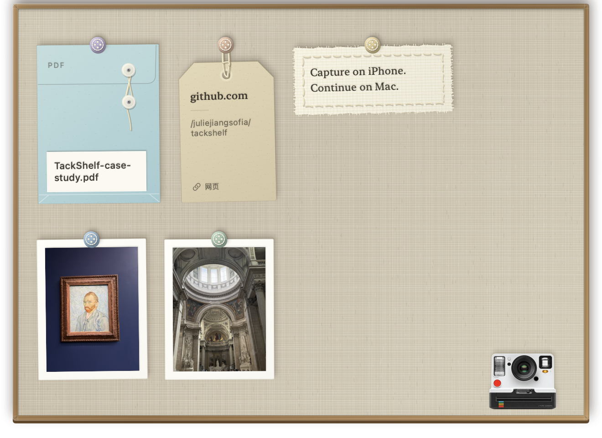

# TackShelf

<p align="center">
  <strong>English</strong> · <a href="README.zh-CN.md">简体中文</a>
</p>

**Capture on iPhone. Continue on Mac.**

TackShelf is a tactile, local-first visual clipboard for macOS. Launch the iPhone camera from your Mac, receive the photo directly, and keep images, text, links, and files as cards you can see and drag into your work.



## Why TackShelf

Moving an iPhone photo into a desktop workflow often means opening a chat app, sending the image to yourself, downloading it, and finding it again. A normal clipboard also hides everything behind one temporary slot.

TackShelf turns those invisible handoffs into a small shelf at the top of the screen.

## Highlights

- **iPhone-to-Mac camera capture** — start a Continuity Camera session on the Mac, take the photo on iPhone, and receive it directly on the shelf and clipboard.
- **Universal Clipboard history** — collect cross-device images after macOS makes them available.
- **More than images** — keep the latest 10 images, text snippets, links, and file batches.
- **Tactile visual language** — photos become prints, text becomes stitched fabric, links become tags, and files become blue document envelopes.
- **Direct manipulation** — click to copy, drag to export, double-click to open, or crumple a card away.
- **Quiet and local-first** — no account, analytics, cloud database, or content upload.

## Interaction

The shelf stays tucked above the display until the pointer rests in the centre of the menu bar. Local clipboard changes are collected silently; an image arriving through Universal Clipboard may briefly reveal the shelf. The camera remains available in the lower-right corner.

Deletion preserves the card's material while it folds into a low-detail paper ball. With Reduce Motion enabled, the same action becomes a short fade.

## Technical overview

| Area | Implementation |
|---|---|
| UI | SwiftUI material cards hosted in a non-activating AppKit panel |
| Clipboard | `NSPasteboard`, delayed Universal Clipboard reads, rich text, URLs, and file representations |
| Cross-device camera | AppKit Continuity Camera helper with a request-scoped handoff |
| Persistence | Local files plus a fixed 10-item index in `UserDefaults` |
| Safety | Private pasteboard types are ignored; external source files are never deleted |
| Compatibility | macOS 14 or later |

The repository includes isolated checks for clipboard ingestion, layout, and the camera handoff. They use private pasteboards, temporary folders, and separate defaults, so they do not touch real clipboard history.

## Build and install

```bash
git clone https://github.com/juliejiangsofia/tackshelf.git
cd tackshelf

TACKSHELF_SDK_PATH=/Library/Developer/CommandLineTools/SDKs/MacOSX14.4.sdk \
  bash scripts/build-preview.sh
bash scripts/install-preview.sh
open ~/Applications/TackShelf.app
```

The local build is ad-hoc signed and intended for development or portfolio review. A public downloadable build would require a Developer ID signature and Apple notarization.

Run the isolated checks:

```bash
bash scripts/check-clipboard.sh
bash scripts/check-board-content.sh
bash scripts/check-phone-camera.sh
```

## Credits and lineage

TackShelf stands on two open-source foundations:

- **[Tendedero](https://github.com/alejandrobujan/tendedero)** by Alejandro Buján — the original menu-bar shelf, panel, screenshot watcher, and direct-manipulation foundation. TackShelf is based on upstream commit `2c3ffd9`; the original code remains under MIT.
- **[ContinuityCapture](https://github.com/techjuicelab/continuity-capture)** by TechJuiceLab — the AppKit Continuity Camera technique used for the iPhone-to-Mac capture flow. The adapted helper preserves its MIT license and source notice.

TackShelf's product direction, multi-type clipboard model, material card system, camera integration, persistence rules, tests, and new artwork were developed for this project. It is an independent modification and is not endorsed by either upstream author.

## License

Original upstream code keeps its MIT terms. TackShelf-specific modifications, visual design, documentation, and new assets are **source-available for noncommercial use only** under the [PolyForm Noncommercial License 1.0.0](https://polyformproject.org/licenses/noncommercial/1.0.0).

Commercial use of the TackShelf-specific work requires separate written permission from `juliejiangsofia`. See [LICENSE](LICENSE) and [THIRD_PARTY_NOTICES.md](THIRD_PARTY_NOTICES.md) for the exact boundary.
