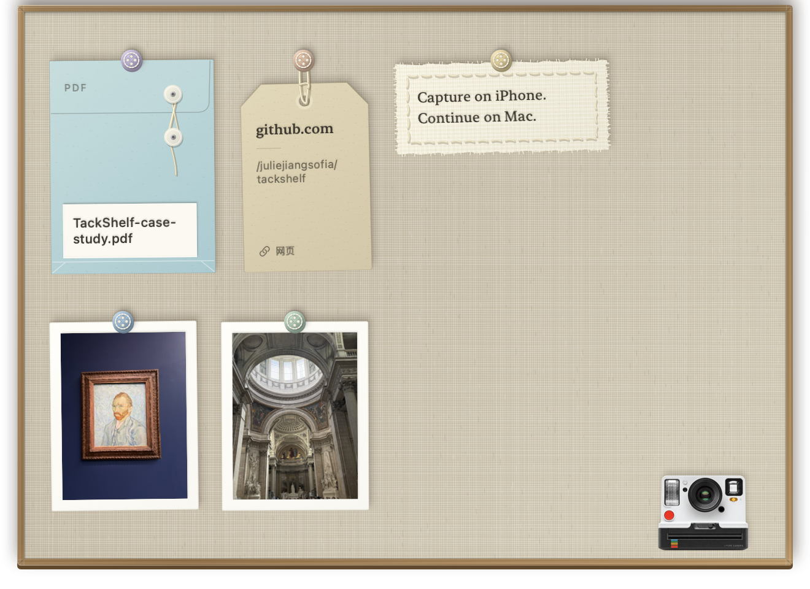

# TackShelf

<p align="center">
  <a href="README.md">English</a> · <strong>简体中文</strong>
</p>

**在 iPhone 拍下，回到 Mac 继续。**

TackShelf 是一款具有实体卡片触感、数据留在本机的 macOS 可视化剪贴板。你可以直接从 Mac 唤起 iPhone 相机，拍完后立即在 Mac 收到照片；图片、文字、网址和文件都会变成看得见、可以拖走的卡片。



## 为什么做 TackShelf

把一张 iPhone 照片放进电脑工作流，常常要先打开聊天软件、发给自己、下载，再重新寻找。普通剪贴板也只有一个看不见的临时位置，新的复制会覆盖旧内容。

TackShelf 把这些看不见的传递过程，变成屏幕顶部的一层小货架。

## 核心功能

- **iPhone → Mac 跨设备拍照**：在 Mac 发起连续互通相机，使用 iPhone 拍摄，照片会直接回到货架并写入剪贴板。
- **通用剪贴板历史**：macOS 接收到其他 Apple 设备复制的图片后，TackShelf 会将其收进历史。
- **不只支持图片**：保存最近 10 条图片、文字、网址和文件批次。
- **实体材质语言**：照片变成相纸，文字变成缝线布片，网址变成吊牌，文件变成蓝色文件袋。
- **直接操作**：点击复制、拖拽导出、双击打开，或把卡片揉成纸团删除。
- **安静且本地优先**：不需要账号，没有分析统计、云端数据库或内容上传。

## 交互方式

货架平时收在屏幕上方，鼠标停在菜单栏中央时才会展开。本机复制的内容会静默收取；通过通用剪贴板到达的图片可以短暂展开货架。相机入口固定在右下角。

删除时会保留卡片原本的材质，并折叠成一个低细节纸团；开启“减弱动态效果”后则使用短暂淡出。

## 技术实现

| 模块 | 实现方式 |
|---|---|
| 界面 | SwiftUI 材质卡片 + 不抢焦点的 AppKit 浮层 |
| 剪贴板 | `NSPasteboard`、通用剪贴板延迟读取、富文本、网址与文件表示 |
| 跨设备拍照 | AppKit 连续互通相机 helper + 单次请求隔离交接 |
| 持久化 | 本地文件 + `UserDefaults` 中固定 10 条索引 |
| 数据安全 | 忽略私密剪贴板类型；绝不删除外部源文件 |
| 系统要求 | macOS 14 或更高版本 |

仓库包含剪贴板收取、板面布局和手机相机交接的隔离检查。测试使用独立剪贴板、临时目录和单独的偏好设置，不会触碰真实历史。

## 构建与安装

```bash
git clone https://github.com/juliejiangsofia/tackshelf.git
cd tackshelf

TACKSHELF_SDK_PATH=/Library/Developer/CommandLineTools/SDKs/MacOSX14.4.sdk \
  bash scripts/build-preview.sh
bash scripts/install-preview.sh
open ~/Applications/TackShelf.app
```

本地构建使用 ad-hoc 签名，适合开发和作品集演示。如果以后提供可直接下载的正式安装包，还需要 Developer ID 签名和 Apple 公证。

运行隔离检查：

```bash
bash scripts/check-clipboard.sh
bash scripts/check-board-content.sh
bash scripts/check-phone-camera.sh
```

## 致谢与代码来源

TackShelf 建立在两个开源项目之上：

- **[Tendedero](https://github.com/alejandrobujan/tendedero)**，作者 Alejandro Buján：提供了最初的菜单栏货架、浮层、截图监听和直接操作基础。TackShelf 基于上游提交 `2c3ffd9`，原始代码继续使用 MIT 许可证。
- **[ContinuityCapture](https://github.com/techjuicelab/continuity-capture)**，作者 TechJuiceLab：提供了 AppKit 连续互通相机的关键实现思路，用于 TackShelf 的 iPhone → Mac 拍照链路。改编后的 helper 完整保留其 MIT 许可证与来源说明。

TackShelf 的产品方向、多类型剪贴板模型、材质卡片系统、相机集成、持久化规则、测试和新视觉资产由本项目完成。本项目是独立修改版，不代表两位上游作者背书。

## 许可证

上游代码继续遵循各自的 MIT 许可证。TackShelf 新增的修改、视觉设计、文档和资产使用 [PolyForm Noncommercial License 1.0.0](https://polyformproject.org/licenses/noncommercial/1.0.0)，**仅允许非商业用途**。

TackShelf 新增部分如需商用，必须另行取得 `juliejiangsofia` 的书面许可。具体边界见 [LICENSE](LICENSE) 和 [THIRD_PARTY_NOTICES.md](THIRD_PARTY_NOTICES.md)。
